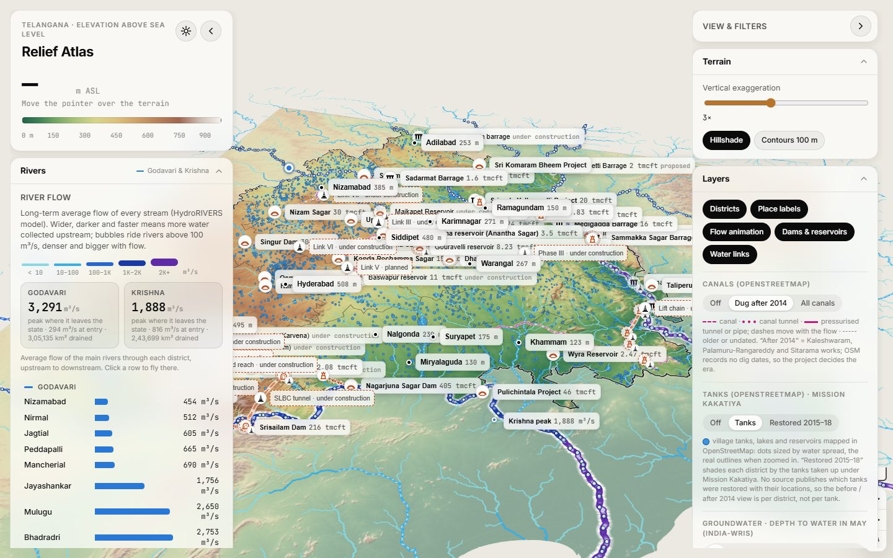
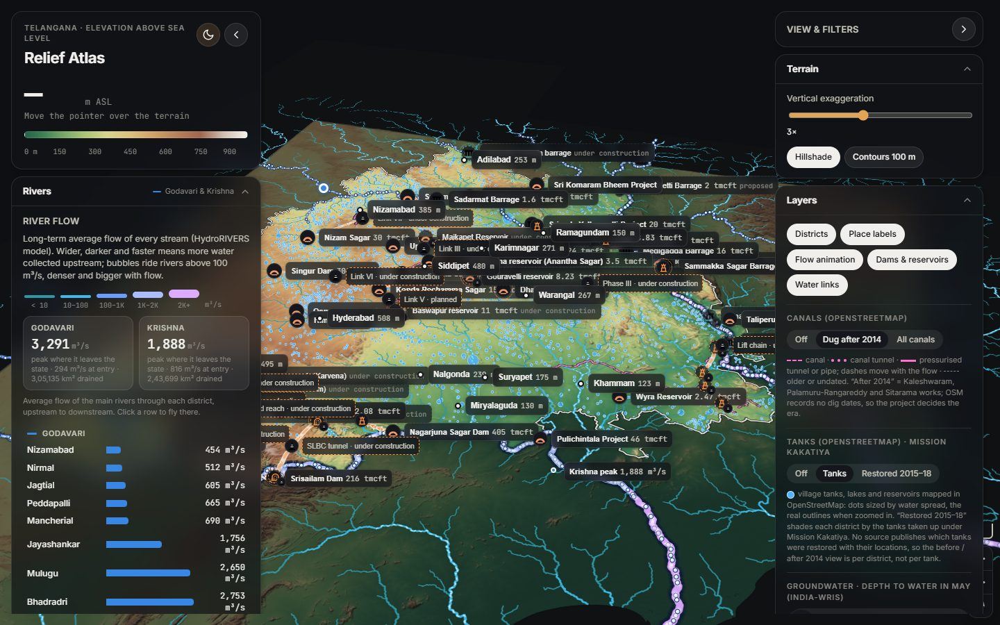
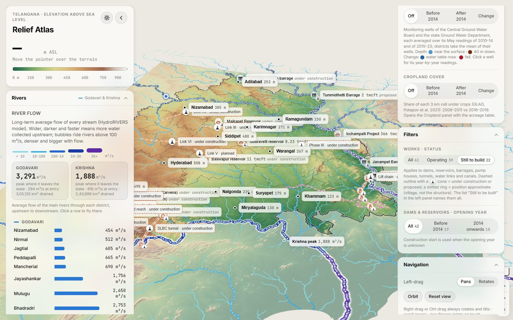
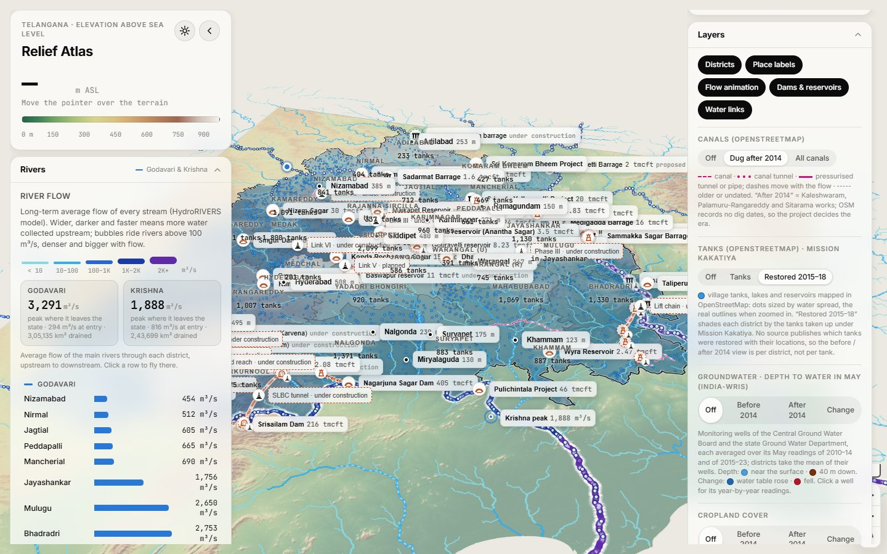
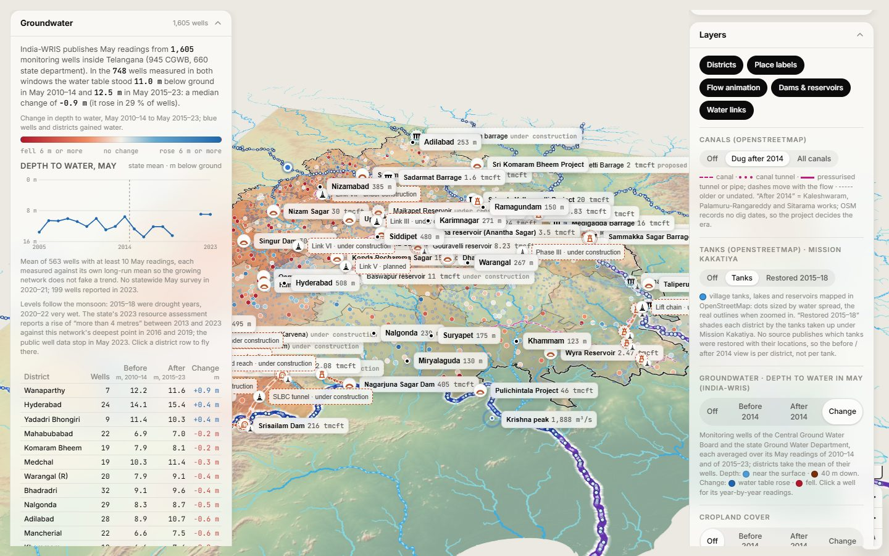
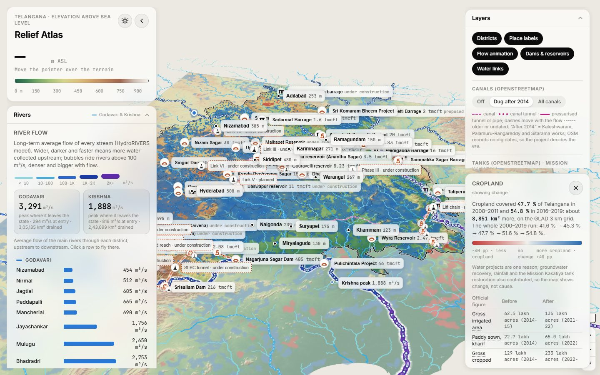
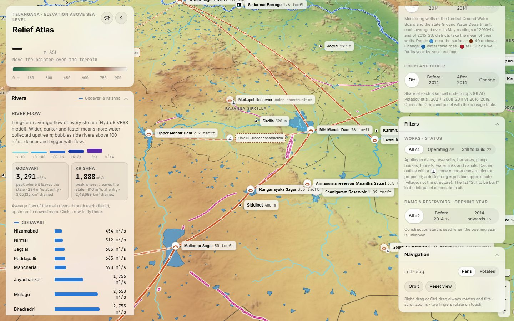

# Telangana 3D terrain

Interactive 3D relief map of Telangana in the browser (elevation above sea
level, Godavari and Krishna river profiles, city elevations), plus a
path-traced 3D terrain block and a native forge3d viewer.

**Live map:** <https://aimedtechgeek.github.io/telangana3d/> (GitHub Pages,
served from the `gh-pages` branch, which holds the built `web/` folder).

## At a glance

| Theme | What the map shows | Where the numbers come from |
|---|---|---|
| Relief | 3D terrain with hillshade and a relief tint over the Mapbox Standard or Satellite basemap, 100 m contours, elevation under the cursor, city heights, Godavari and Krishna river-bed profiles | Mapbox Terrain-DEM for the surface, Copernicus GLO-90 DEM for the figures |
| River flow | Every stream drawn and animated by its long-term average discharge; peak flow where each river leaves the state; flow per district | HydroRIVERS (HydroSHEDS) |
| Water works | Dams, barrages, reservoirs, pump houses and the links that move water between them, each with status (operating, under construction, proposed), years, heights and capacity; a "Still to be built" list | Wikipedia and Wikidata infoboxes, OpenStreetMap, CAG audit, CWC replies, news (every entry cites its source) |
| Canals | Canals, tunnels and pressure mains dug after 2014 or all of them; the Kaleshwaram network figures against what OSM has mapped | OpenStreetMap, CAG |
| Tanks | About 4,800 village tanks and lakes; districts shaded by tanks restored under Mission Kakatiya 2015–18 | OpenStreetMap, Government of India report |
| Groundwater | 1,605 monitoring wells with depth to water in May before (2010–14) and after 2014 (2015–23), the change per well and district, a state curve 2005–2023 | India-WRIS via India Data Portal |
| Cropland | Share of land under crops before and after 2014 and the change, with cultivated area per district | GLAD global cropland (Potapov et al. 2021) |
| Proposal | A planning sketch of river water for 85 % of cultivable land: six multi-stage trunk systems, new reservoir sites, lift deliveries, pump stages, tunnels, canals, gravity commands and indicative costs, set against the state's river-water shares | Computed from the terrain, HydroRIVERS, ESA WorldCover and the works on the map, under an engineering review's norms |

Every figure on the map is traceable in [DATA_SOURCES.md](DATA_SOURCES.md);
sources that could not be reached are listed in
[README_UNREACHABLE_SOURCES.md](README_UNREACHABLE_SOURCES.md).

## Screenshots

**Overview**: relief, river flow, dams and barrages with capacities, water links
with moving chevrons, tanks as blue dots, and the collapsible cards on both
sides.



**Dark theme**: follows the OS setting, toggle in the top-left card.



**Still to be built**: the Status filter keeps only the works under
construction or proposed (dashed outline and cone), with the pending links
and canals.



**Mission Kakatiya**: districts shaded and labelled by the tanks taken up for
restoration in 2015–18, from the Government of India report.



**Groundwater before and after 2014**: wells and districts coloured by the
change in May depth to water between 2010–14 and 2015–23 (red fell, blue
rose); the Groundwater card carries the state curve and the district table.



**Cropland change**: more (blue) or less (red) land under crops between
2008–11 and 2016–19, with the Cropland card's state figures.



**Kaleshwaram country up close**: Mid Manair, Ranganayaka Sagar and Mallanna
Sagar with the links, the canals and tunnels dug after 2014 (magenta) and the
real outlines of the tanks.



## Web map (Mapbox GL JS)

On phones and tablets (viewport 900 px wide or less) the left panel and the right stack become bottom sheets: each is a 48 px handle that expands to 60 % of the screen on tap, one at a time, and the map keeps the whole viewport.

The map runs on Mapbox GL JS v3 with the Mapbox Standard basemap (or Standard
Satellite) under the atlas layers and Mapbox Terrain-DEM as the 3D surface, so
it needs a Mapbox public token. Create one at account.mapbox.com with the
default public scopes, restrict it to `http://127.0.0.1:8765/*` (and the Pages
URL, see below), and put it in a User environment variable `MAPBOX_TOKEN`.
`serve.py` writes it into `web/mapbox-token.js`, which is git-ignored; nothing
else needs the token.

```powershell
uv run python serve.py      # http://127.0.0.1:8765/ opens in your browser
```

- 3D terrain with hillshade and a colour scale in metres above sea level
- Hover anywhere for the elevation under the cursor, shown as a stack of
  landmark silhouettes for scale (Gateway of India 26 m, Charminar 56 m,
  Qutub Minar 73 m, Statue of Unity 182 m)
- Hover a district to tint and outline it and see its name, its mean river flow
  (the flow summary) and its mapped tank count; the popup stays away from tank outlines,
  wells, dams, links and streams under the pointer and from any open popup. A hovered
  stream turns brighter and wider. Both use feature state: districts are keyed by
  `shapeName` (`promoteId`, GeoJSON and hosted tiles alike); `flow.geojson` has no
  id property, so streams get generated ids on the GeoJSON path, and stream hover is
  untested and probably inactive when the flow layer is served as hosted vector tiles
  (the published tiles have no id property to promote; not verified against a live tileset)
- Steeply tilted views (pitch above 55) drop town, pump-house and proposal place labels
  beyond a distance from the view centre (`['distance-from-center']`, shrinking as
  the pitch rises), so the far side of the 3D view stays readable. The tank dots are
  not covered: Mapbox accepts those expressions only in symbol-layer filters
- **River flow:** every stream drawn by its long-term average discharge
  (HydroRIVERS): wider, darker and faster-moving dashes mean more water
  collected upstream. Hover a stream for its m³/s and catchment area; peak
  markers show where the Godavari and Krishna carry the most water; a list
  gives the average flow of each river through every district it crosses
- **Water links:** orange lines show how water is moved between the
  structures by Kaleshwaram, the Sriram Sagar canals, the Srisailam Left Bank
  Canal, Kalwakurthy and Palamuru-Rangareddy. Operating links carry moving
  chevrons in the direction of flow; links still being built are dashed with
  a work-in-progress cone. Click a link (on the map or in the list) for its
  status, years (planned, construction, first water, complete), terrain
  heights at both ends, straight-line distance and source. Lines are
  schematic, not real canal alignments, and are drawn as overhead pipes: lifted
  about 120 m above the ground at district level (scaled with the terrain
  exaggeration) so they clear the hills
- **River bed on the map:** the river selected in the River profiles card is
  drawn on the map as a line that takes the relief colours of its bed, from the
  profile's elevations; it follows the Godavari / Krishna tab
- **Orbit:** the dam popup and the proposal reservoir popup have an Orbit
  button; the free camera circles the structure at a 4 km radius about 2,500 m
  above the exaggerated terrain, one turn in 24 s. Drag, scroll, touch, Esc or
  starting a river flight stops it
- **Canals, tunnels and pressure mains** (OpenStreetMap): thin magenta
  dashed lines whose dashes move with the flow; canal tunnels are dotted
  with a wide casing, pressurised tunnels/pipes solid. The Canals control
  shows those dug after 2014 (Kaleshwaram and Sitarama works, by project
  since OSM has no dig dates) or everything with the older ones faint. Click
  one for its name, scheme and length. A table under Water links sets the
  official Kaleshwaram network figures (planned 1,832 km; CAG: 57 % of main
  canals and 7 % of distributaries built by March 2022) against what OSM has
  mapped
- **Cropland cover** (GLAD, Potapov et al. 2021): the Agriculture control
  switches a raster of the share of land under crops for 2008–2011 ("Before
  2014"), 2016–2019 ("After 2014") or the change between them, and opens a
  Cropland card on the right with the state and per-district cultivated area
  before and after (lakh acres, change in acres, CSV download) and the
  official irrigated-area statistics. The data show the change, not its cause.
  With a "Before 2014" or "After 2014" layer on, the Cropland card has a
  **Blend** slider (0 = 2008–11, 100 = 2016–19) that cross-fades the two
  rasters (both are drawn, with complementary `raster-opacity`); the legend
  and the card's subtitle show the blend position. The tabs set it to 0 or 100
  and the change map is not affected
- **Years** (Filters card): a slider from the earliest year in the data to 2026
  with a Play button (one year every 600 ms) and "All years". While it is
  active, dams and their 3D walls, water links (line, pulse, arrows, hit area,
  under-construction labels) and canals show only features with a year at or
  before the slider value; features with no year hide. A year is: dams, opened
  else began; links, done, else water, began or planned; canals, era "after"
  counts as 2015 and "before" as 1970 (OSM has no dig date). Years are
  precomputed on the loaded GeoJSON, one shared `yearFilter()` composes with the
  status and opening-year filters, and the readout ("By 1990: 12 dams · 3
  links · canals after 2014 hidden") counts from the loaded data, not from the
  rendered tiles. Pump houses are not filtered by year (they carry none)
- Godavari and Krishna river-bed and flow profiles through the state; hover or
  drag the slider to follow the river on the map, click to fly there
- Dams (arch icon) and barrages (gated-deck icon), including the Kaleshwaram
  barrages and its Mallanna Sagar, Konda Pochamma Sagar and Ranganayaka Sagar
  reservoirs. Labels show name and gross capacity; clicking one zooms in and
  opens a popup with height, construction-start–opening years, the average
  river inflow at that point (HydroRIVERS) and capacity
- **Dams as 3D walls:** the Dams & reservoirs chip also extrudes the OpenStreetMap
  crest line of 13 dams (Nagarjuna Sagar, Srisailam, Sriram Sagar, Nizam Sagar,
  Jurala and others) into a wall as high as the dam; with the proposal on, each
  proposed reservoir gets a wall as high as its dam. Click a wall for the
  popup. Heights are exaggerated with the terrain, see DATA_SOURCES.md 6b.
- **Still to be built:** every dam, reservoir, barrage, pump house, tunnel,
  water link and canal carries a status (operating, under construction,
  proposed). The Status filter on the right shows only the operating works or
  only the pending ones; pending markers have a dashed outline and a cone,
  approximate positions (a village standing in for the structure) a dotted
  ring. A "Still to be built" list in the left panel groups them by scheme
  (Kaleshwaram Link III/V/VI/VII and Baswapur, the Palamuru-Rangareddy
  reservoirs and tunnels, Dindi, the SLBC tunnel, Devadula Phase III, Sitamma
  Sagar and the four Sitarama pump houses, Chanaka–Korata, Gouravelli,
  Tummidihetti, Icchampally …) with the
  years and last announced target; works with no published location are
  listed in grey
- **Tanks** (OpenStreetMap): about 4,800 village tanks, lakes and reservoirs
  of 0.5 ha or more as blue dots sized by water spread, with their real
  outlines when zoomed in; click one for its name, area and district. The
  Tanks card gives the Mission Kakatiya figures (46,531 tanks to restore,
  27,318 taken up in four phases 2015–18, Government of India report) by
  district next to what OSM has mapped, and the "Restored 2015–18" view
  shades each district by tanks taken up, since no source publishes which
  tanks were restored with their locations
- **Groundwater** (India-WRIS): 1,605 CGWB and state-department monitoring wells with their mean depth to water in May before 2014 (2010–14) and after (2015–23), the change per well and per district, a year-by-year state curve, and popups with each well's readings. Depth is below ground, so the drought years 2015–18 show as a fall and the wet 2020–22 monsoons as a recovery.
- **Proposal** (a planning sketch, off by default): the "Show proposal" control
  in the Filters card draws what it would take to put 85 % of the state's
  cultivable land under river water, computed by `propose_water.py` from the
  terrain, HydroRIVERS flows, ESA WorldCover land cover and the works already
  on the map, under norms set by a lift-irrigation engineering review: new
  reservoirs sited on the DEM, lift deliveries for districts without a dam
  site, six multi-stage trunk systems that reuse Kaleshwaram's, Devadula's and
  Palamuru's stages and add new ones, the cheapest feed for each work (river
  intake, existing reservoir or canal, trunk stage or cascade), pump stages,
  tunnels, deep cuts, canals and pressure mains routed inside the state, and
  the land gravity could then serve. Everything drawn is marked "new" with its
  TMC; the Proposal card gives the water budget against the Godavari and
  Krishna shares, every system and work with its lift, route and indicative
  cost, the per-district need, the engineering caveats and the norms
- 27 cities and towns ranked by elevation, with the lowest river beds for
  comparison; click one to fly to it
- Both side columns are stacks of small collapsible cards, one per category.
  Left: Elevation (live readout and colour scale), Rivers (flow and
  profiles), Water works (links, Kaleshwaram network, still to be built), Tanks,
  Groundwater and Cities. Right: Terrain (exaggeration, hillshade, contours), Layers
  (districts, place labels, flow animation, dams, water links, canals,
  tanks, groundwater, cropland), Filters (works status, dams' opening year) and Navigation (drag
  mode, orbit, reset); the Cropland card opens beneath them. Click a card's
  title to fold it away. Light/dark theme follows the OS setting; the toggle
  in the left panel overrides it
- Mouse: left-drag pans (switch "Left-drag" to *Rotates* for a full 360° orbit
  with tilt), right-drag or Ctrl-drag always rotates and tilts, scroll zooms

### Fonts

Panels use Inter (Google Fonts); map labels use Mapbox's DIN Pro. To set the
labels in Inter too, create a secret token with the `fonts:write` scope at
account.mapbox.com, put it in `MAPBOX_SECRET_TOKEN` and run
`python upload_font.py`. It downloads Inter Regular, Medium and Bold from the
official rsms/inter release, uploads them to your Mapbox account through the
Fonts API and writes `web/data/fonts.json`; with that file present the map asks
for `Inter Medium` (label font constant `LABEL_FONT` in `web/app.js`), without
it DIN Pro stays. `serve.py` answers `data/fonts.json` and `data/tilesets.json` with an
empty `{}` while they do not exist, so the default page load logs no console errors; a
static host without that fallback (GitHub Pages) logs a harmless 404 for each file.
`tilesets.json` is read once, by a synchronous request at load (the style needs it at once).

Not yet run against a real account: `upload_font.py` has not been executed against a real Mapbox account, so the upload and the `fonts.json` it writes are untested.

### Camera

During a river flight the field of view narrows to 28 degrees (the `fov` camera
option, experimental in Mapbox GL JS 3.28 and later) and returns to the
previous value when the flight stops. The opening flight starts at zoom 5.2,
looking straight down from above the state, and settles at the home view.

Everything in `web/` is served as static files. The browser fetches Mapbox GL
JS, the Standard basemap, the Terrain-DEM tiles and the label fonts from Mapbox
(one map load per visit, free up to 50,000 a month) and the panel fonts from
Google.

## forge3d (native)

```powershell
uv run python view.py                 # native viewer window + console prompt
uv run python block.py                # path-traced block -> out/telangana_block.png
uv run python block.py --interactive  # rotate the block in the viewer
```

In the native viewer, left-drag orbits, the wheel zooms, W/A/S/D tilt and
rotate. It has no mouse pan, so type a place name at the prompt, `all`, `list`,
`x 60` (exaggeration, `x auto` to reset) or `q`.

## Rebuild the data

```powershell
uv run python fetch_data.py       # downloads into data/raw (~250 MB); the small OSM, Wikipedia
                                  # and Wikidata snapshots are committed, so only the big
                                  # stable files (DEM, HydroRIVERS, boundaries, GLAD) are fetched
uv run python prepare_data.py     # mosaic, reproject, clip -> data/
uv run python make_overlay.py     # map colours and lines -> data/overlay.png (forge3d)
uv run python build_web_data.py   # profiles, contours, layers -> web/data (and Terrarium tiles -> web/tiles, no longer used by the map)
uv run python build_flow_raster.py   # optional: river velocity GeoTIFF -> data/flow_velocity.tif
uv run python publish_flow_raster.py # optional: publish it as a Mapbox raster-array tileset (needs MAPBOX_SECRET_TOKEN and `pip install mapbox-tilesets`);
                                     # the map then draws river particles instead of the canvas bubbles (see DATA_SOURCES.md 5b)
uv run python propose_water.py    # the Proposal view: reservoir sites, routes, pump houses -> web/data/proposal.*
uv run python web_smoke_test.py   # headless Edge check of the web map -> out/web_home.png
```

## Publish to GitHub Pages

The site is the `web/` folder as built above (without `tiles/`, which the
Mapbox build no longer reads), pushed to the `gh-pages` branch together with
`.github/workflows/pages.yml` and a `.nojekyll` file. On every push to
`gh-pages` that workflow writes `mapbox-token.js` from the repository secret
`MAPBOX_TOKEN` and deploys the folder with `actions/deploy-pages`, so the
token is never committed (it is still visible to visitors, as any browser
token is, which is why it must be URL-restricted). One-time setup in the repo
settings: *Secrets and variables → Actions → New repository secret*
`MAPBOX_TOKEN`, a public `pk.` token restricted to
`https://aimedtechgeek.github.io/*`; and *Pages → Source: GitHub Actions*.
After rebuilding `web/`, redeploy from the repo root:

```bash
git worktree add ../telangana3d-pages gh-pages          # once per clone
SRC=$(git rev-parse --short HEAD)
rm -rf ../telangana3d-pages/data ../telangana3d-pages/tiles
cp -r web/data web/index.html web/app.js web/style.css ../telangana3d-pages/
mkdir -p ../telangana3d-pages/.github/workflows && cp .github/workflows/pages.yml ../telangana3d-pages/.github/workflows/
cd ../telangana3d-pages && git add -A && git commit -m "Deploy the built map from $SRC" && git push
```

Every URL in `web/` is relative, so the same files work locally and under the
project path.

### Hosted tiles

Not yet run against a real account: `publish_tilesets.py` and `publish_flow_raster.py` have not been executed against a real Mapbox account, so the upload, the status polling and the `tilesets.json` they write are untested.

By default the map fetches about 18 MB of GeoJSON at boot. `publish_tilesets.py`
instead uploads the static layers to Mapbox as vector tilesets (Mapbox Tiling
Service) so the map loads only the tiles in view:

```bash
export MAPBOX_SECRET_TOKEN=sk....        # secret token with tilesets:read, tilesets:write, tilesets:list
uv run python publish_tilesets.py        # or name layers: publish_tilesets.py flow tanks
```

It covers `flow`, `tanks`, `tank_points`, `canals`, `contours`, `districts`,
`mask`, `state` and `groundwater` (zoom 5 to 12, simplified harder at low
zoom), publishes each as `<username>.tg-<layer>`, waits for the job and writes
`web/data/tilesets.json` (layer to `mapbox://` url and source layer). The user
name is read from the public token (`MAPBOX_TOKEN`, JWT field `u`) or given
with `--username`. Without the secret token the script exits with code 2.
The converter adds a numeric `year` property to the `canals` features (era
"after" = 2015, "before" = 1970) that the Years slider filters on: **tilesets
published before this change lack it, so republish `canals`
(`publish_tilesets.py canals`) or the Years slider hides every canal on the
hosted-tiles path.** The links are always GeoJSON, so they get theirs at load.

The map reads `data/tilesets.json` at boot: present, the mapped layers become
`vector` sources; absent, everything loads from GeoJSON exactly as before, so
deleting the file switches back. `links` and `proposal` always stay GeoJSON
(they need `lineMetrics` and change often); flow, tank counts, district label
points and the proposal are still fetched as small JSON where the panels
need them. `web/data/` is git-ignored, so copy `tilesets.json` along with the
rest when you redeploy. Re-run the script after rebuilding the data. Free tier
and terms: DATA_SOURCES.md, section 1c.

## Data and choices

Full provenance, licences, access dates and processing notes for every dataset
are in [DATA_SOURCES.md](DATA_SOURCES.md). The sources that could not be reached,
and what stands in for them, are listed by topic in
[README_UNREACHABLE_SOURCES.md](README_UNREACHABLE_SOURCES.md).

| Item | Source / value |
|---|---|
| Elevation | Copernicus GLO-90 DSM (AWS open data), smoothed (σ = 1 px); 200 m grid for forge3d, the river profiles, city heights and the proposal model. The web map's 3D surface, hillshade, relief tint and cursor readout come from Mapbox Terrain-DEM v1, so the readout always matches the surface drawn (Hyderabad reads 504 m there against 508 m in the Copernicus list) |
| State and 33 districts | geoBoundaries gbOpen India ADM1/ADM2 |
| Rivers | Natural Earth 10m centrelines (profiles, names) |
| River flow | HydroRIVERS v1.0 (HydroSHEDS): `DIS_AV_CMS`, the long-term average *naturalised* discharge from the WaterGAP model, i.e. before dams and irrigation withdrawals; reaches ≥ 1 m³/s. Per-district values are length-weighted means of the main stem inside the district |
| Cities | OpenStreetMap `place=city`, plus towns with population ≥ 40 000 (Overpass API); elevation = median DSM within 1 km |
| River profiles | DSM 10th percentile within 1.4 km of the centreline every 2 km, median-filtered, then capped so the bed never rises downstream (the coarse line strays onto the valley sides in the Krishna's Nallamala gorge) |
| Dams and barrages | Wikipedia: every page linked from "List of dams and reservoirs in Telangana" (plus the border dams and Kaleshwaram barrages) that has a dam infobox with coordinates; proposed or unfinished ones are skipped. Height = the infobox `dam_height` (above river bed), or height above foundation when that is all the page gives |
| Projection | Web Mercator for the web map; Lambert Conformal Conic for forge3d |
| Vertical exaggeration | Web: 3× default (1–6×); forge3d map 50×/30×/20× by zoom; block 12× |

Notes:
- geoBoundaries still has `Warangal (R)` and `Warangal (U)`. In August 2021
  they became Warangal and Hanumakonda, and some mandals moved between them,
  so the names *and* the shared boundary of these two districts may predate
  that change. Names are shown as published, except the source's `Hydrabad`
  typo, which is corrected.
- The DSM includes trees and buildings, so city values can sit a few metres
  above street level, and river beds are approximate.
- Flow figures are modelled long-term averages, not gauge readings: actual
  flow varies hugely between monsoon and dry season and is reduced by the
  Sriram Sagar, Nagarjuna Sagar and other projects.
- Dam heights are whatever the Wikipedia infobox states and are not all
  measured the same way; the Kaleshwaram barrages (Medigadda, Annaram,
  Sundilla) and the new Kaleshwaram reservoirs have no published height, so
  their labels carry none. Years are construction start and opening (no
  source records a proposal year); the smaller Kaleshwaram "online storages"
  are missing because nothing publishes their coordinates (see DATA_SOURCES.md).
- The forge3d viewer DEM uses a local grid (1 unit = 20 m) because the viewer
  clamps mouse-wheel zoom to a 100–50 000 unit radius.
- The block render is downsampled to 400 m and rendered in 800 px tiles to fit
  the path tracer's 512 MB budget.
